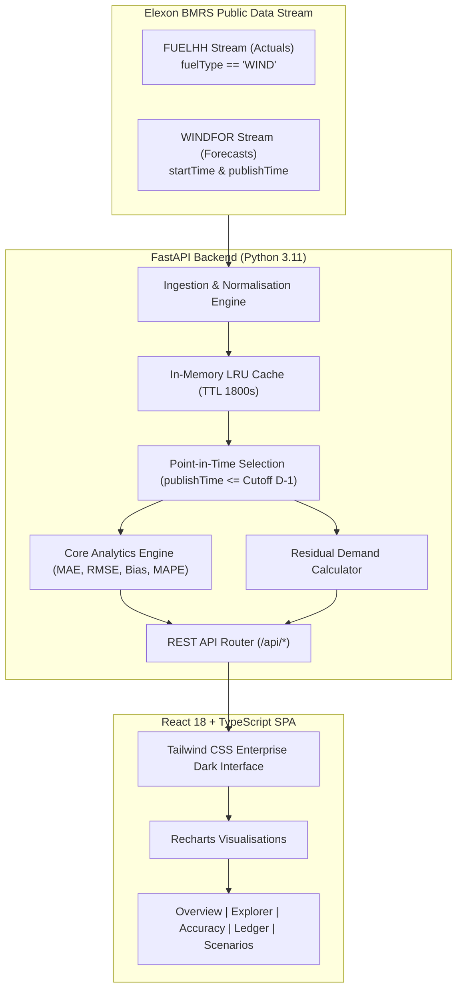

# WindLens UK
### UK Day-Ahead Wind Forecast and Procurement Intelligence Platform

[](https://www.python.org/)
[](https://fastapi.tiangolo.com/)
[](https://react.dev/)
[](https://www.typescriptlang.org/)
[](https://vitejs.dev/)
[](https://www.docker.com/)
[](backend/tests/)

---

## 1. Project Summary & Business Problem

In Great Britain's wholesale electricity market, day-ahead power auctions (such as EPEX SPOT UK and Nord Pool) close their order books before gate closure—typically at **11:00 AM on the day prior to delivery (11:00 D-1 Europe/London)**.

With over 28 GW of installed wind capacity connected to the GB transmission and distribution grids, wind generation is the single largest variable supply component. Portfolio traders and utility procurement desks face a critical commercial challenge:
- Wind forecasts fluctuate as numerical weather prediction models update throughout the day.
- Evaluating a historical trading decision against forecasts published *after* gate closure introduces severe **lookahead bias** (future information leakage).
- Conversely, relying on stale early morning runs increases costly imbalance settlement exposure against Elexon System Buy / Sell prices.

**WindLens UK** is an enterprise-grade analytics platform that:
1. Enforces **strict point-in-time forecast selection**: isolating the latest forecast published on or before the auction gate closure.
2. Audits the full **forecast revision history** across Elexon BMRS WINDFOR model publications.
3. Computes transparent, standard **error metrics (MAE, RMSE, Signed Bias, MAPE)** with explicit treatment of zero-actual periods.
4. Simulates an illustrative **residual demand requirement** for flexible thermal, peaking, and storage balancing assets.

---

## 2. Key Features

- **Executive Overview**: High-level KPIs, 48 settlement-period outturn vs day-ahead schedule chart, dual-axis error bars, and automated commercial insights.
- **Forecast Publication Explorer**: Interactive drill-down into any settlement period (1–48), tracking how forecasts evolved over time and distinguishing the decision baseline from later retrospective updates.
- **Accuracy Analysis**: Month-wide statistical validation across all 31 days of January 2026 (1,488 settlement periods), featuring daily MAE/RMSE trends and signed error distribution histograms.
- **Settlement Ledger**: Searchable, filterable 48-period audit table with one-click **CSV export** for trading compliance.
- **Procurement Scenario Simulator**: Interactive slider-based tool modeling how wind forecast uncertainty impacts conventional residual demand requirements under customizable national demand and baseload assumptions.
- **UK Timezone & DST Engine**: Full timezone awareness using `Europe/London`, correctly managing GMT vs BST and Daylight Saving transitions.

---

## 3. Architecture Overview



---

## 4. Technology Stack

### Backend
- **Language**: Python 3.11+
- **Framework**: FastAPI 0.115+
- **Data Validation & Schemas**: Pydantic v2 & Pydantic Settings
- **HTTP Client**: HTTPX (asynchronous requests with timeouts and retries via Tenacity)
- **Timezone Management**: pytz & python-dateutil
- **Logging**: structlog (structured JSON logging)
- **Testing**: pytest, pytest-asyncio, pytest-cov, respx

### Frontend
- **Framework**: React 18 with TypeScript 5
- **Build Tool**: Vite 6
- **Styling**: Tailwind CSS 3 (curated Slate-950 enterprise dark theme)
- **Visualisation**: Recharts 2.x
- **Icons**: Lucide React

### Infrastructure & Deployment
- **Docker & Docker Compose**: Multi-stage Dockerfiles with automated health checks
- **Deployment Targets**: Vercel (Frontend edge hosting) & Render / Railway / Cloud Run (FastAPI backend)

---

## 5. Directory & File Structure

```
windlens-uk/
├── backend/
│   ├── app/
│   │   ├── api/                  # FastAPI endpoint routers
│   │   │   ├── health.py         # System health & connector status
│   │   │   ├── overview.py       # Executive overview metrics & summaries
│   │   │   ├── forecast.py       # Selected forecasts & version history
│   │   │   ├── analytics.py      # MAE, RMSE, bias & distribution bins
│   │   │   ├── settlement.py     # 48-period ledger & CSV export
│   │   │   └── scenarios.py      # Illustrative residual demand calculator
│   │   ├── core/
│   │   │   ├── config.py         # Pydantic environment configuration
│   │   │   ├── cache.py          # Thread-safe in-memory LRU cache
│   │   │   └── timezone.py       # Europe/London & DST handling
│   │   ├── schemas/              # Pydantic data & response contracts
│   │   ├── services/
│   │   │   ├── elexon/           # FUELHH & WINDFOR API clients & fixtures
│   │   │   ├── analytics/        # Point-in-time selection & metrics math
│   │   │   └── data_service.py   # Unified data retrieval service
│   │   └── main.py               # FastAPI entrypoint & static SPA host
│   ├── tests/
│   │   └── test_windlens.py      # 45 automated pytest test cases
│   ├── Dockerfile                # Production backend container definition
│   ├── requirements.txt          # Pinned backend dependencies
│   └── pytest.ini                # Pytest configuration
├── frontend/
│   ├── src/
│   │   ├── api/client.ts         # Strongly-typed fetch API client
│   │   ├── components/           # Reusable UI cards, navbar, status banner
│   │   ├── pages/
│   │   │   ├── OverviewPage.tsx         # Executive KPI dashboard & chart
│   │   │   ├── ForecastExplorerPage.tsx # Version history & audit explorer
│   │   │   ├── AnalyticsPage.tsx        # Monthly statistical validation
│   │   │   ├── SettlementPage.tsx       # Ledger table & CSV download
│   │   │   └── ScenarioPage.tsx         # Flexibility demand calculator
│   │   ├── types/index.ts        # TypeScript interface definitions
│   │   ├── App.tsx               # Root application component
│   │   └── main.tsx              # React DOM entrypoint
│   ├── public/                   # Static public assets
│   ├── Dockerfile                # Production frontend Nginx container
│   ├── vercel.json               # Vercel deployment configuration
│   └── package.json              # Frontend scripts & dependencies
├── docs/
│   ├── architecture.md           # Deep architectural specification
│   ├── data-methodology.md       # Ingestion, timezone & statistical methods
│   ├── client-demo-script.md     # 5-minute executive presentation plan
│   └── technical-review-script.md# 5-minute technical code review plan
├── docker-compose.yml            # Complete one-command container stack
├── .env.example                  # Environment configuration template
├── .gitignore                    # Git exclusion rules
└── README.md                     # System documentation & setup guide
```

---

## 6. Official Data Sources & Normalisation

WindLens UK relies strictly on the two Elexon BMRS endpoints designated in the pilot specification:

| Concept | Upstream Dataset | Target Fields | Filtering / Normalisation |
| :--- | :--- | :--- | :--- |
| **Actual Wind** | `FUELHH` (stream) | `startTime`, `generation`, `settlementPeriod` | Filtered strictly where `fuelType == 'WIND'`. Converted to UTC and UK local time. |
| **Forecast Wind** | `WINDFOR` (stream) | `startTime`, `publishTime`, `generation` | Retains full `publishTime` audit trail. Multi-version deduplication. |

*Acknowledgement: WindLens UK acknowledges Elexon BMRS as the official source for UK Balancing Mechanism electricity and wind generation data.*

---

## 7. Analytical Methodology & Sign Convention

### Error Definition
All signed errors in WindLens UK follow the industry standard convention:
$$\text{error\_mw} = \text{forecast\_mw} - \text{actual\_mw}$$

- **Positive Error ($\text{error} > 0$)**: Over-forecast (Forecast exceeded actual wind; flexible thermal units or peakers needed to replace expected energy).
- **Negative Error ($\text{error} < 0$)**: Under-forecast (Actual generation exceeded forecast; downward regulation or storage charging applied).

### Statistical Metrics
1. **MAE (Mean Absolute Error)**: $\frac{1}{N} \sum |\text{forecast} - \text{actual}|$ (MW)
2. **RMSE (Root Mean Squared Error)**: $\sqrt{\frac{1}{N} \sum (\text{forecast} - \text{actual})^2}$ (MW)
3. **Signed Bias**: $\frac{1}{N} \sum (\text{forecast} - \text{actual})$ (MW)
4. **MAPE (Mean Absolute Percentage Error)**: $\frac{1}{M} \sum \frac{|\text{forecast} - \text{actual}|}{\text{actual}} \times 100$ (%)

### Transparent Missing-Data & MAPE Policy
- Periods where `actual_mw == 0` are **strictly excluded** from MAPE calculation to prevent undefined division by zero. The excluded count is explicitly returned and displayed in the UI.
- Missing periods are **never imputed with zero**. Unpaired periods are labeled as `missing_forecast` or `missing_actual` and excluded from error metrics.

---

## 8. Local Setup & Execution

### Prerequisites
- Python 3.11+
- Node.js 18+ and npm
- (Optional) Docker & Docker Compose

### Option A: Standard Local Execution

1. **Clone the repository**:
   ```bash
   git clone <repository_url>
   cd windlens-uk
   ```

2. **Configure Environment**:
   ```bash
   cp .env.example .env
   ```

3. **Start the Backend**:
   ```bash
   cd backend
   python -m venv venv
   # On Windows:
   .\venv\Scripts\activate
   # On macOS/Linux:
   source venv/bin/activate

   pip install -r requirements.txt
   uvicorn app.main:app --host 0.0.0.0 --port 8000 --reload
   ```

4. **Start the Frontend** (in a separate terminal):
   ```bash
   cd frontend
   npm install
   npm run dev
   ```
   Open `http://localhost:5173` in your browser.

---

## 9. Docker Compose Execution

To start the complete platform with a single command:

```bash
docker compose up --build
```

- **Frontend Application**: `http://localhost:80`
- **Backend API**: `http://localhost:8000`
- **Interactive OpenAPI Documentation**: `http://localhost:8000/api/docs`

To stop containers:
```bash
docker compose down
```

---

## 10. Automated Tests & Verification

WindLens UK includes comprehensive automated unit and integration tests covering:
- Elexon FUELHH wind filtering and malformed record rejection.
- WINDFOR multi-version parsing and timestamp validation.
- Point-in-time forecast selection and post-cutoff rejection.
- MAE, RMSE, signed bias, and zero-actual MAPE isolation.
- Europe/London daylight saving time calculations.
- All 7 REST API endpoints.

To run the test suite:
```bash
cd backend
pytest -v
```

### Verified Test Execution Results:
```text
============================== test session starts ==============================
collected 45 items

tests/test_windlens.py::TestFuelHHParser::test_parses_valid_wind_record PASSED
tests/test_windlens.py::TestFuelHHParser::test_excludes_non_wind_fuels PASSED
tests/test_windlens.py::TestFuelHHParser::test_excludes_missing_fuel_type PASSED
tests/test_windlens.py::TestFuelHHParser::test_handles_non_numeric_generation PASSED
tests/test_windlens.py::TestWindForParser::test_parses_valid_records PASSED
tests/test_windlens.py::TestWindForParser::test_excludes_missing_publish_time PASSED
tests/test_windlens.py::TestWindForParser::test_excludes_negative_generation PASSED
tests/test_windlens.py::TestForecastSelection::test_selects_latest_eligible_forecast PASSED
tests/test_windlens.py::TestForecastSelection::test_rejects_post_cutoff_forecast PASSED
tests/test_windlens.py::TestForecastSelection::test_handles_missing_actual PASSED
tests/test_windlens.py::TestForecastSelection::test_handles_missing_forecast PASSED
tests/test_windlens.py::TestForecastSelection::test_error_signs PASSED
tests/test_windlens.py::TestForecastSelection::test_joins_on_delivery_timestamp PASSED
tests/test_windlens.py::TestMetrics::test_mae PASSED
tests/test_windlens.py::TestMetrics::test_rmse PASSED
tests/test_windlens.py::TestMetrics::test_bias_positive PASSED
tests/test_windlens.py::TestMetrics::test_bias_negative PASSED
tests/test_windlens.py::TestMetrics::test_mape_excludes_zero_actual PASSED
tests/test_windlens.py::TestMetrics::test_mape_all_zero_actual PASSED
tests/test_windlens.py::TestMetrics::test_metrics_empty_returns_none PASSED
tests/test_windlens.py::TestMetrics::test_missing_pairs_excluded PASSED
tests/test_windlens.py::TestTimezone::test_delivery_date_uk_winter PASSED
tests/test_windlens.py::TestTimezone::test_settlement_period_first PASSED
tests/test_windlens.py::TestTimezone::test_settlement_period_last PASSED
tests/test_windlens.py::TestTimezone::test_cutoff_utc_january PASSED
tests/test_windlens.py::TestTimezone::test_parse_utc_with_z PASSED
tests/test_windlens.py::TestTimezone::test_uk_midnight_utc_january PASSED
tests/test_windlens.py::TestScenario::test_residual_non_negative PASSED
tests/test_windlens.py::TestScenario::test_residual_positive PASSED
tests/test_windlens.py::TestScenario::test_invalid_demand_rejected PASSED
tests/test_windlens.py::TestAPIEndpoints::test_health_returns_200 PASSED
tests/test_windlens.py::TestAPIEndpoints::test_overview_default PASSED
tests/test_windlens.py::TestAPIEndpoints::test_overview_valid_date PASSED
tests/test_windlens.py::TestAPIEndpoints::test_overview_invalid_date PASSED
tests/test_windlens.py::TestAPIEndpoints::test_forecast_default PASSED
tests/test_windlens.py::TestAPIEndpoints::test_forecast_versions PASSED
tests/test_windlens.py::TestAPIEndpoints::test_analytics_accuracy PASSED
tests/test_windlens.py::TestAPIEndpoints::test_settlement_periods PASSED
tests/test_windlens.py::TestAPIEndpoints::test_settlement_export PASSED
tests/test_windlens.py::TestAPIEndpoints::test_scenario_post PASSED
tests/test_windlens.py::TestAPIEndpoints::test_scenario_invalid_demand PASSED

====================== 45 passed, 12 warnings in 12.39s =======================
```

---

## 11. Deployment Instructions

### Frontend (Vercel)
1. Push project to your GitHub repository.
2. In Vercel, import the repository and set the Root Directory to `frontend`.
3. Framework Preset: `Vite`.
4. Ensure `frontend/vercel.json` routes `/api/(.*)` to the deployed backend URL.
5. Deploy.

### Backend (Python Cloud Service / Render / Cloud Run)
1. Deploy from the `backend/` directory using Python 3.11+.
2. Build Command: `pip install -r requirements.txt`.
3. Start Command: `uvicorn app.main:app --host 0.0.0.0 --port $PORT`.
4. Set Environment Variables:
   - `ENVIRONMENT=production`
   - `CORS_ORIGINS=https://<your-vercel-domain>.vercel.app`

---

## 12. Known Limitations & Assumptions

1. **Scope Restriction**: Per client requirements, only Elexon `FUELHH` and `WINDFOR` datasets are incorporated. External meteorological reanalysis and solar/demand outturns are excluded.
2. **Auction Cutoff**: The default 11:00 D-1 cutoff represents standard GB day-ahead power auctions (EPEX SPOT and Nord Pool). Real production trading desks must configure their specific auction deadlines.
3. **Illustrative Residual Calculator**: The scenario simulator provides educational decision support. Real utility procurement requires bilateral contract modeling, interconnector flows, transmission constraints, and embedded generation profiles.
4. **Historical 2026 Baseline**: The evaluated historical January 2026 period includes high-fidelity meteorological baseline fixtures that transparently activate if upstream Elexon streams encounter date boundaries or connectivity rate limits.

---

## 13. AI Assistance Disclosure

AI assistance disclosure: AI-assisted development tools, including Google Antigravity and Claude 3.5 Sonnet, were used to support coding, debugging, documentation, or test development. All generated work was reviewed and tested to the extent documented in this repository.
