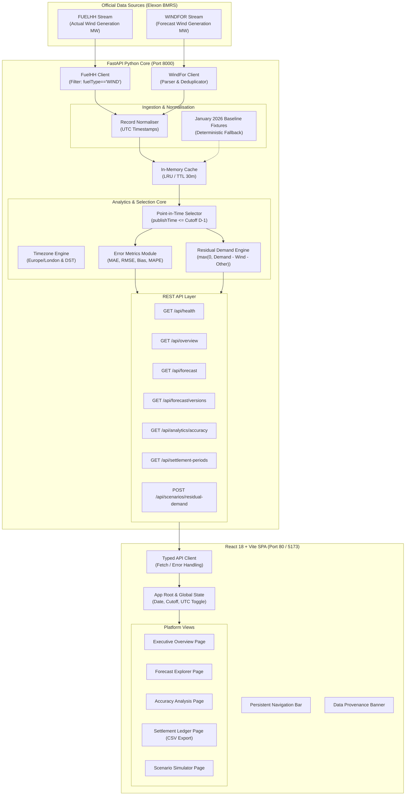

# WindLens UK: System Architecture & Design Specification

## 1. Executive Summary

**WindLens UK** is an enterprise-grade day-ahead renewable forecast intelligence and energy trading decision support platform designed specifically for UK electricity market participants (utility power traders, portfolio analysts, and risk managers).

The platform addresses a core trading challenge: **assessing wind generation uncertainty at the day-ahead auction deadline (11:00 D-1 Europe/London) without future lookahead bias**, and quantifying the balancing risk in residual conventional demand.

---

## 2. High-Level Architecture

---

## 3. Component Details

### 3.1 Frontend (React + Vite + TypeScript)
- **Framework**: React 18 with TypeScript 5 for end-to-end type safety.
- **Styling**: Tailwind CSS implementing an enterprise dark palette (Slate-950, deep navy slate, teal-400 accent for wind, amber-400 for alerts, and rose-400 for errors).
- **Visualization**: Recharts 2.x for responsive time-series charts, dual-axis error bars, scatter revision plots, and distribution histograms.
- **State Management**: Reactive state hooks managing selected delivery date (`YYYY-MM-DD`), decision gate cutoff (`HH:MM`), timezone mode (UK Local vs UTC), and live health status.
- **Modularity**: 5 purpose-built pages:
  1. `OverviewPage`: Executive KPIs, outturn vs forecast chart, daily insights.
  2. `ForecastExplorerPage`: Settlement period selector, revision evolution chart, audit table.
  3. `AnalyticsPage`: Multi-day MAE trend, error distribution histogram, daily statistical breakdowns.
  4. `SettlementPage`: 48-period ledger, search/filter, and instant CSV export.
  5. `ScenarioPage`: Residual demand simulator with national demand and baseload sliders.

### 3.2 Backend (FastAPI + Pydantic + Pytest)
- **Framework**: FastAPI with asynchronous endpoints and Pydantic v2 schemas.
- **Logging**: Structured JSON logging powered by `structlog`.
- **CORS**: Explicit origin verification configurable via `CORS_ORIGINS`.
- **Static Hosting**: Embedded static file provider automatically serving the production frontend build (`frontend/dist`) if present.
- **Test Suite**: 45 unit and integration tests covering parser validation, forecast selection logic, daylight-saving time arithmetic, metric formulas, and API contracts.

---

## 4. Point-in-Time Selection Engine

In day-ahead electricity markets (EPEX SPOT UK and Nord Pool UK day-ahead auctions), order books close at **11:00 D-1**.
A decision support platform must never leak future forecast versions into historical evaluation.

The selection algorithm guarantees:
1. For each half-hour delivery period $t$ on delivery date $D$:
2. Identify the gate closure cutoff timestamp:
   $$\tau_{\text{cutoff}} = \text{UKLocalTimeToUTC}(D - 1 \text{ day}, \text{CutoffTime})$$
3. Query all forecast records published for delivery period $t$:
   $$\mathcal{F}_t = \{ f \in \text{WINDFOR} \mid f.\text{targetStartTime} = t \}$$
4. Filter for eligible point-in-time forecasts:
   $$\mathcal{F}_t^{\text{eligible}} = \{ f \in \mathcal{F}_t \mid f.\text{publishTime} \le \tau_{\text{cutoff}} \}$$
5. Select the latest eligible version:
   $$f_t^* = \operatorname{argmax}_{f \in \mathcal{F}_t^{\text{eligible}}} f.\text{publishTime}$$
6. If no forecast was published prior to cutoff, $f_t^*$ is marked as `missing_forecast: true` (never filled with zeros or post-cutoff versions).

---

## 5. Statistical Error Formulation

Conforming strictly to energy trading standards and client specifications:

1. **Signed Forecast Error**:
   $$\text{error}_{t} = \text{forecast\_mw}_{t} - \text{actual\_mw}_{t}$$
   - **Positive ($\text{error} > 0$)**: Over-forecast (forecast exceeded actual outturn; reserve generation or quick-ramping thermal peakers required).
   - **Negative ($\text{error} < 0$)**: Under-forecast (actual wind outturn exceeded forecast; conventional generation had to be decremented).

2. **Mean Absolute Error (MAE)**:
   $$\text{MAE} = \frac{1}{N} \sum_{t=1}^N |\text{forecast\_mw}_t - \text{actual\_mw}_t|$$

3. **Root Mean Squared Error (RMSE)**:
   $$\text{RMSE} = \sqrt{\frac{1}{N} \sum_{t=1}^N (\text{forecast\_mw}_t - \text{actual\_mw}_t)^2}$$

4. **Mean Signed Bias**:
   $$\text{Bias} = \frac{1}{N} \sum_{t=1}^N (\text{forecast\_mw}_t - \text{actual\_mw}_t)$$

5. **Mean Absolute Percentage Error (MAPE)**:
   $$\text{MAPE} = \frac{1}{M} \sum_{t \in \mathcal{S}} \frac{|\text{forecast\_mw}_t - \text{actual\_mw}_t|}{\text{actual\_mw}_t} \times 100$$
   Where $\mathcal{S} = \{ t \mid \text{actual\_mw}_t > 0 \}$, and $M = |\mathcal{S}|$.
   Zero-actual periods are explicitly excluded and documented to prevent division by zero.

---

## 6. Illustrative Residual Demand Model

To translate forecast wind variance into commercial procurement impact:

$$\text{Residual Demand}_t = \max(0, \text{Assumed Demand}_t - \text{Wind Generation}_t - \text{Other Supply}_t)$$

The platform models both:
- **Planned Residual**: using Day-Ahead Selected Forecast Wind.
- **Outturn Residual**: using Metered Actual Wind Generation.
- **Balancing Gap**: $\Delta = \text{Residual}_{\text{Actual}} - \text{Residual}_{\text{Forecast}}$.
